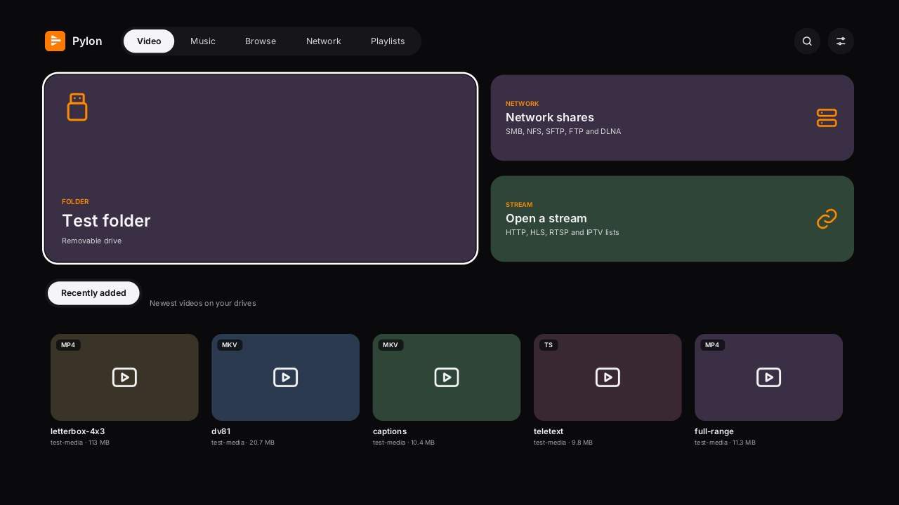
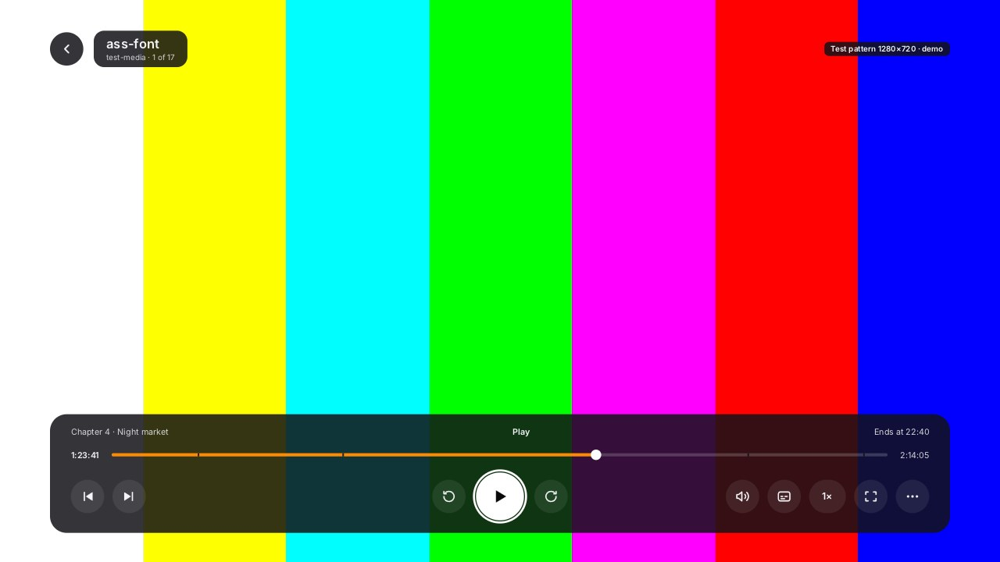
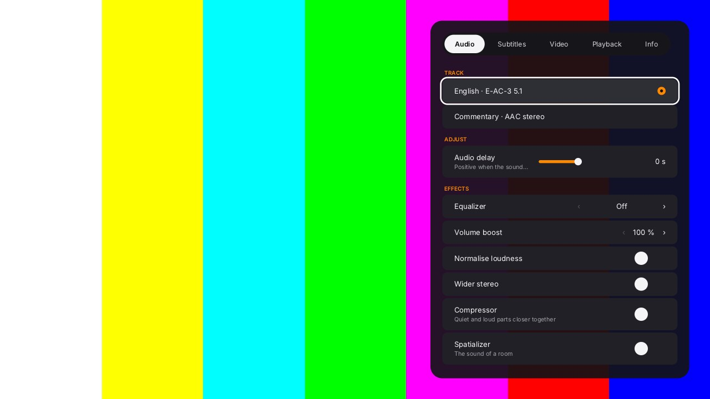
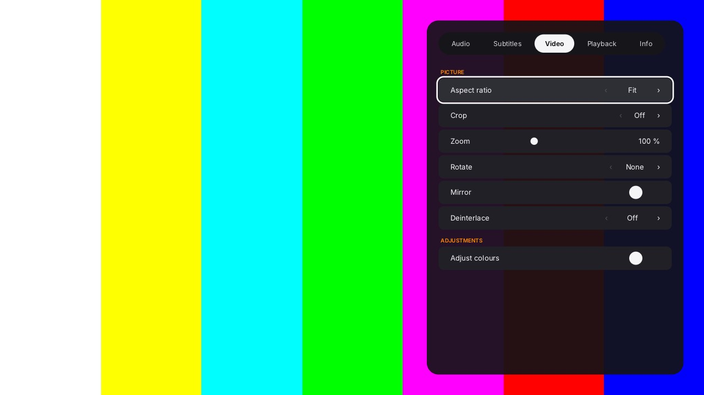
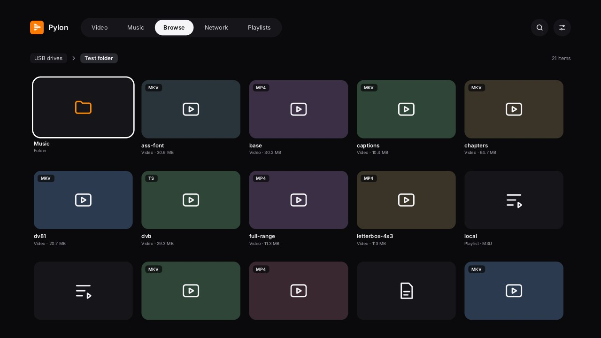
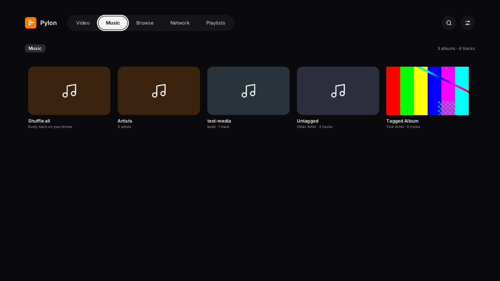
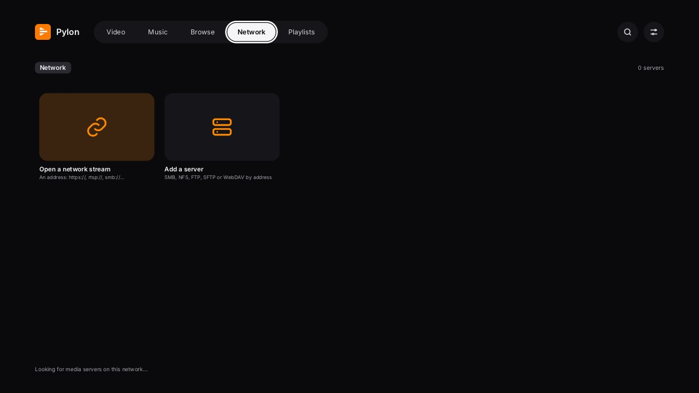
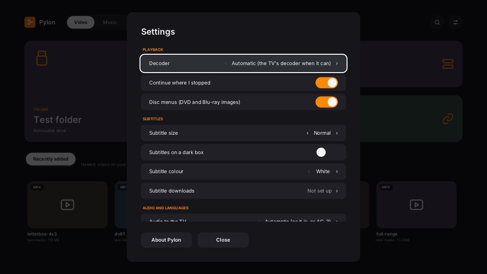

# Pylon: libVLC for LG webOS

Pylon (code name VPlayer, app id `com.sostk.vplayer`) is a native LG webOS app that brings VLC's playback engine (libVLC 3.0.24) to the TV: a remote-driven
UI on [webos-native-app-kit](https://github.com/Native-Webos/webos-native-app-kit), with the TV's hardware decoder
for 4K/HDR and VLC's software decoders for everything else.

Not affiliated with VideoLAN. "VLC" is a VideoLAN trademark.

- Design and evidence: [docs/RESEARCH.md](docs/RESEARCH.md)
- Plan and status: [docs/ROADMAP.md](docs/ROADMAP.md)

## What it does

**Playing**

- Everything VLC 3.0.24 plays, through VLC's own demuxers and decoders
- The TV's hardware decoder for H.264, HEVC, VP9 and AV1 up to 4K, with HDR10 and Dolby Vision
  (profiles 8.1 and 7); anything the TV refuses falls back to VLC's decoders on its own
- Audio passed to the TV as it is (AC-3, E-AC-3), re-encoded to AC-3, or always decoded to PCM
- DVD images and `VIDEO_TS` folders with their menus, driven by the remote
- Seeking, jump to time, chapters and titles, speed from 0.25× to 4× with the pitch kept, frame by
  frame, A-B repeat, repeat, sleep timer, bookmarks, and resume with "Continue watching"

**Sources**

- USB drives, with thumbnails, search and "Recently added"
- SMB 2/3 shares with sign-in (saved, encrypted where the TV can), DLNA servers found on the
  network, FTP and SFTP
- HTTP(S) and HLS streams, and M3U, PLS and XSPF playlists, IPTV lists with groups and channel logos
- Your own playlists, and a music view with albums, covers and shuffle

**Subtitles and captions**

- SubRip, styled ASS/SSA with attached fonts, WebVTT, MP4 text, PGS, DVD and DVB pictures, teletext
  subtitles, and CEA-608 and CEA-708 closed captions
- Subtitle files beside the video, locally or on a share, and downloads from OpenSubtitles with
  your own API key
- Delay, size, colour and a background box

**Audio and picture**

- Audio track and delay, equalizer (presets and your own bands), volume boost to 200 %, normalise,
  wider stereo, compressor, spatializer, pitch shift, and visualisations for music
- Aspect ratio, zoom and crop; rotate, mirror, deinterlace, picture adjustments and snapshots when
  VLC draws the picture

**On the TV**

- Every action with the remote's arrows, OK and Back (no colour keys needed); the pointer works too
- Tested on an LG OLED65C1 (webOS 6.5.3), see [docs/TV-TEST-PLAN.md](docs/TV-TEST-PLAN.md); the
  package loads on webOS 5.3 to 11.2

## Screenshots

| | |
|---|---|
| <br>Home | <br>Playback |
| <br>Audio: tracks, delay and effects | <br>Picture: aspect, crop, zoom, rotate |
| <br>A USB folder | <br>Music |
| <br>Network shares and streams | <br>Settings |

## Layout

| Path | What |
|---|---|
| `app/` | The webOS app (C++17, kit app shell). Created with the kit's `tools/new-app.py`. |
| `libvlc/` | Cross-build of VLC 3.0.24 contribs + libvlc + plugins, inside Docker. |
| `libvlc/patches/` | Our patches to VLC 3.0.24 and its contribs (applied by `libvlc/build.sh`). |
| `modules/` | Our own VLC modules: `wnk_bridge` (streams to the TV decoder), `wnk_keystore` (saved sign-ins). |
| `third_party/` | VLC source checkout (not committed). |
| `build/` | All build output (not committed). |

## Build

Needs: Docker, the webosbrew NDK at `~/webos-ndk/arm-webos-linux-gnueabi_sdk-buildroot` (or
`WEBOS_NDK=…`), and the kit at `../native-webos/webos-native-app-kit` (or `WNK_KIT_DIR=…`).

```sh
libvlc/build.sh image       # once
libvlc/build.sh contribs    # ~1 h the first time
libvlc/build.sh vlc         # → build/libvlc/stage/usr/lib/{libvlc.so*,libvlccore.so*,vlc/plugins}

cd app
./build.sh                  # host build + smoke test
./build.sh webos            # ipk
./build.sh install && ./build.sh launch
```

## Trying it

- Desktop screenshots: `app/tools/host-shots.sh OUT_DIR [SAMPLE_FOLDER]` (the sample folder appears
  as an extra drive through `VPLAYER_EXTRA_ROOT`).
- On the TV, open a folder directly: `ares-launch -d tv com.sostk.vplayer -p '{"browse":"/tmp/usb/sda/sda1"}'`.

## Releases and the Homebrew Channel

Each release on GitHub carries the `.ipk` and `com.sostk.vplayer.manifest.json`, made from it by
`app/tools/make-manifest.py IPK TAG OUT.json`. The Homebrew Channel registration
(`app/packaging/com.sostk.vplayer.yml`) points at the newest full release's manifest, so a release
must not be marked as a pre-release to reach the channel. Listing icons: `app/packaging/icon160.png`
and `icon320.png` (`app/tools/make-icons.py`).

## Licence

GPL-3.0-or-later (the kit is GPL-3.0+; libVLC is LGPL-2.1+, VLC modules GPL-2.0+/LGPL).
